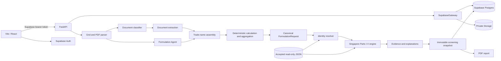
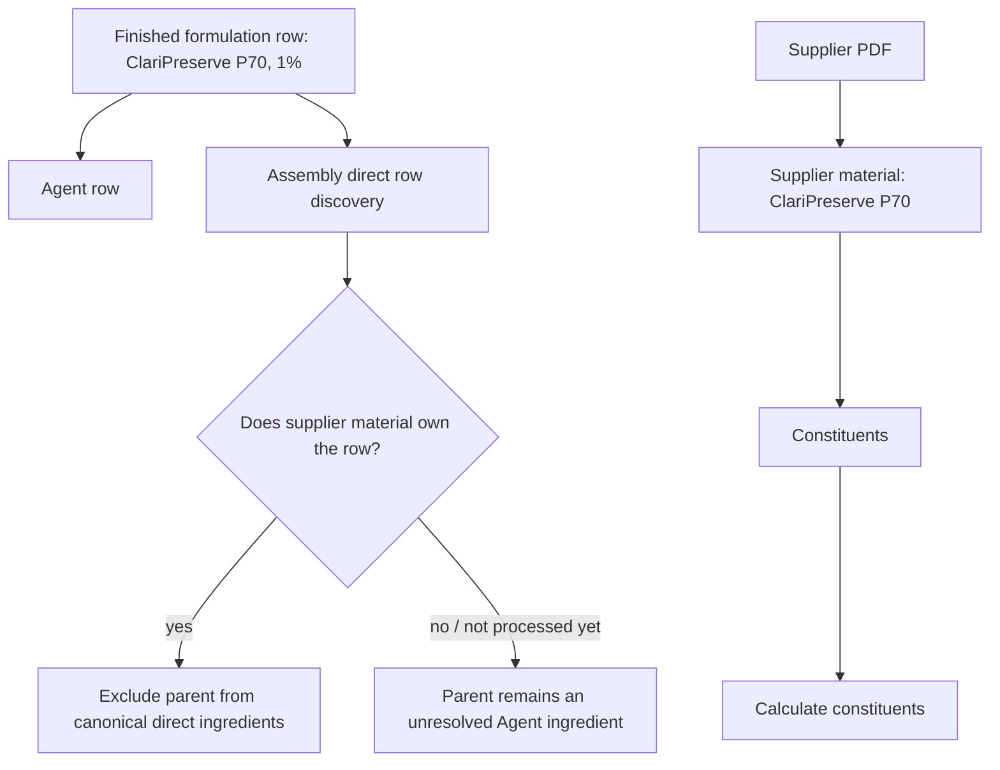
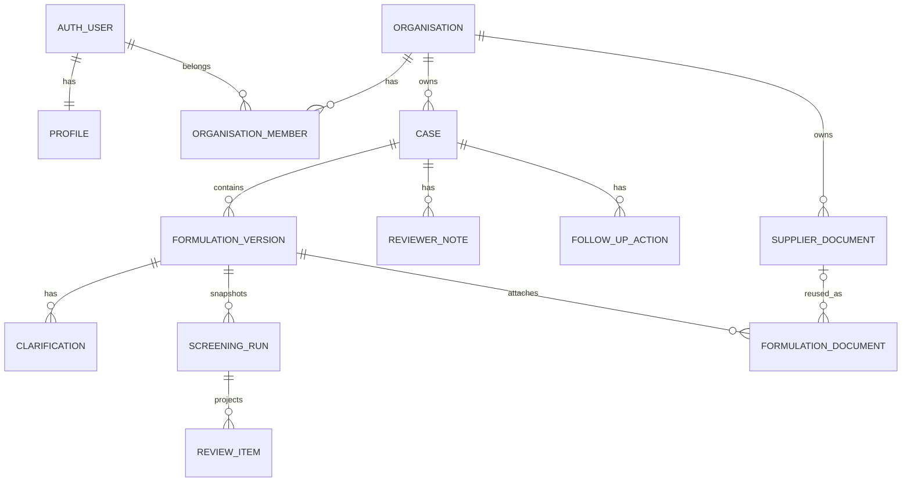
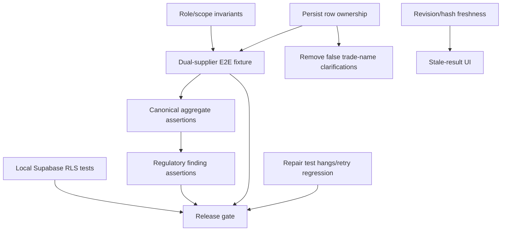

# Regulens Technical Handover, Bug Audit, and UX Workflow Review

**Audit date:** 9 November 2026 (Asia/Singapore)  
**Repository:** `C:\Users\joshu\SOC_VIP`  
**Audited commit:** `0adabdb` (`Tradename Feature`)  
**Scope of this document:** current working tree, including the multi-document/trade-name implementation.  
**Safety boundary:** Regulens is a source-backed screening assistant. It does not approve a cosmetic product, certify safety, or replace professional review.

> Evidence labels used below:
>
> - **Verified:** inspected in code and exercised by a test in this audit.
> - **Code-supported:** established by code inspection, but the complete browser/API/database flow was not executed.
> - **Previously reported:** recorded in `STATUS.md` or prior project output but not rerun in this audit.
> - **Unverified:** a plausible risk or intended capability that still needs an end-to-end test.

---

## 1. Executive summary

Regulens has grown well beyond the original four-day MVP. The current repository contains:

- Supabase email/password authentication and organisation-scoped private cases;
- persistent formulation versions, clarifications, screening snapshots, review status, notes, and follow-ups;
- private source-file storage and a reusable supplier-document library;
- CSV, Excel, text, JSON, and selectable-text PDF intake;
- AI-assisted formulation interpretation with strict source-reference validation;
- deterministic supplier-composition extraction, document-local code legends, range arithmetic, contribution calculation, and aggregation;
- the accepted Singapore Parts I–V screening baseline and ACD comparison evidence;
- immutable screening history, source evidence, and PDF reports.

The underlying domain boundaries are largely correct: supplier materials are modelled separately from their constituents, calculated contributions are aggregated before screening, and formulation-level coverage is represented separately from ingredient findings. Focused deterministic document/calculation tests passed **66/66** in this audit.

The main stability risk is the integration seam between the original Formulation Agent and the newer supplier-material assembly. A trade-name row is first interpreted by the Agent, where it is legitimately unresolved as a chemical name. The frontend hides that row only after the supplier assembly reports a matching handled material name. If supplier extraction is incomplete, misclassified, stale, or has not yet reached the UI, the commercial name leaks back into the ordinary ingredient clarification flow and becomes a false mandatory identity problem. The same class of role/scope failure previously allowed supplier percentages to be treated as finished-product percentages, producing impossible `>100%` aggregates. Current classifier/extractor changes and unit tests address the known synthetic layouts, but a persisted three-file authenticated workflow has not been rerun in this audit.

There is also a confirmed stale-result problem: editing material usage, constituents, document choice, or assembly state does not clear or visibly mark the currently displayed historical screening run as stale. The next run is correct only after the user explicitly screens again. Historical snapshots should remain immutable, but the UI must distinguish them from current input.

### Recommended immediate order

1. Add one explicit backend ownership contract for formulation rows (`direct_ingredient` versus `supplier_material`) and stop relying on frontend name matching.
2. Add a real authenticated end-to-end dual-supplier test from upload through canonical request, screening snapshot, and results table.
3. Invalidate or visibly stale-mark results whenever the Agent revision or assembly revision changes.
4. Make every blocking assembly issue navigate to a concrete editable field; downgrade non-correctable evidence limits to coverage warnings.
5. Repair the failing Agent retry test and the hanging `AgentPage` frontend test before treating the suite as a release gate.

### Current readiness judgement

**Not ready for an unsupervised external pilot.** The deterministic regulatory engine and calculation primitives are strong enough for controlled engineering tests, but the multi-document orchestration still has P0 risks around parent-material ownership and end-to-end screening inputs. A supervised internal pilot is reasonable only if every canonical request and aggregate is inspected before conclusions are shared.

---

## 2. Product overview and governing principles

### 2.1 Intended users

- cosmetic manufacturers and OEM/ODM teams;
- regulatory consultants;
- cosmetic formulators;
- small in-house regulatory teams.

### 2.2 Intended value

The product should reduce repetitive first-pass work:

```text
upload evidence
  -> interpret formulation and supplier materials
  -> calculate finished-product ingredient amounts
  -> resolve ingredient identity conservatively
  -> apply deterministic Singapore rules
  -> present source-backed findings for professional review
```

The user should only have to decide things the source evidence cannot decide safely: which revision applies, what a genuinely missing usage is, which ambiguous identity is intended, or what product condition applies.

### 2.3 Non-negotiable rules

The repository-level rules in `AGENTS.md` remain applicable:

1. Regulatory findings come from accepted structured regulatory data, not model opinion.
2. Ambiguous identity or rule applicability remains a review/incomplete outcome.
3. Original wording and provenance are retained.
4. No whole-product “approved” or “compliant” conclusion is allowed.
5. Supplier non-disclosure is evidence scope, not permission to invent composition.
6. AI may interpret and explain; it may not change regulatory outcomes.

### 2.4 Scope discrepancy to keep visible

`VIP_SoC_Cosmetics_MVP_Scope.md` describes a narrower Parts I–II-era MVP and depicts regulatory rules in a database. The actual application now loads a read-only, byte-hashed filesystem baseline covering Singapore Parts I–V and stores only user/domain data and immutable result snapshots in Supabase. The current implementation—not the original diagram—is the operational architecture. The original document remains useful for product safety boundaries.

---

## 3. Current implemented capabilities

| Capability | Current implementation | Evidence level |
|---|---|---|
| Authentication | Supabase email/password browser session; bearer token to FastAPI | Code-supported |
| Private workspaces | organisations, memberships, RLS, plus backend membership checks | Code-supported; local DB rerun unavailable in this audit |
| Persistent cases | cases and monotonic formulation versions | Code-supported |
| Source storage | private `formulation-files` bucket; signed download URLs | Code-supported |
| Formulation interpretation | strict Agent output with exact cell references; deterministic fast path for explicit spreadsheets | Verified in focused tests, with one retry regression |
| PDF intake | selectable text locally; bounded Vision retry path for image-only supplier documents | Deterministic path verified; live Vision not rerun |
| Supplier library | organisation-scoped reusable exact source documents keyed by SHA-256 | Code-supported |
| Document revisions | lineage, governing revision, conflict protection | Focused tests included in collected suite; not rerun against DB |
| Trade-name assembly | parent material, constituents, material usage, direct ingredients | Verified at unit/service level |
| Code legends | per-document legends and coded ranges | Verified at unit/service level |
| Concentration arithmetic | exact/range/bounds/approximate/unknown and qualified totals | Verified at unit/service level |
| Aggregation | verified identity group + compatible semantics before screening | Verified at unit/service level |
| Regulatory engine | accepted Singapore Parts I–V, ACD comparison evidence | Accepted-data audit passed with warnings/source review item |
| Review workspace | immutable findings plus reviewer status, notes, follow-ups | Code-supported and frontend tests observed passing |
| Reporting | PDF screening report and calculation provenance | Code-supported; production build passed |
| Permanent deletion | cases, formulation versions, account domain cleanup | Code-supported; not DB-rerun here |

---

## 4. Repository and runtime architecture

### 4.1 Repository map

```text
backend/app/
  main.py                         FastAPI bootstrap, stores/services/CORS
  routes/cases.py                 authenticated case/document/assembly/screening API
  routes/screening.py             ad-hoc screening and public source endpoints
  models/document_intake.py       document, material, quantity, issue, assembly models
  models/formulation.py           canonical FormulationRequest
  models/screening.py             bounded findings and evidence response
  services/agent_csv.py           grid/PDF/spreadsheet parsing
  services/formulation_agent.py   strict Agent interpretation + clarifications
  services/document_classifier.py deterministic role classification
  services/document_extraction.py deterministic supplier/direct extraction
  services/document_vision.py     bounded OpenAI Vision adapter
  services/supplier_documents.py  processing, reuse, retry, leases
  services/trade_name_assembly.py source-to-assembly state reconciliation
  services/material_calculation.py quantity validation/contribution/aggregation
  services/formulation_assembly.py canonical prepared assembly
  services/resolver.py             deterministic identity resolution
  services/compliance.py           per-rule deterministic evaluation
  services/formulation.py          formulation-level orchestration
  services/evidence.py             source-backed result assembly
  services/review_explanations.py deterministic/model explanation layer
  services/screening_report.py     PDF report
  services/supabase_gateway.py     trusted service-role persistence gateway

frontend/src/
  pages/CasePage.tsx
  pages/FormulationWorkspacePage.tsx
  pages/AgentPage.tsx
  components/SupplierDocumentsPanel.tsx
  components/TradeMaterialAssemblyPanel.tsx
  components/ScreeningResultsPanel.tsx
  components/ResultsTable.tsx
  components/EvidenceDrawer.tsx
  api/cases.ts, api/screening.ts, api/reports.ts

supabase/migrations/
  20261013000100_persistent_cases.sql
  20261014000100_professional_review_workspace.sql
  20261019000100_parts_i_v_review_findings.sql
  20261022000100_permanent_deletion_controls.sql
  20261107000100_trade_name_documents.sql
  20261108000100_trade_name_document_integrity.sql
```

### 4.2 Runtime component diagram



### 4.3 Important implementation seam

The old Agent and new assembly both see the finished-formulation source:



The current frontend additionally hides Agent rows by comparing normalised names reported by the assembly (`AgentPage.tsx:155-173`). That is a presentation workaround, not a durable ownership contract. It is the root of several confusing states.

---

## 5. End-to-end data flow and API contracts

### 5.1 Initial case/formulation upload

`POST /cases/{case_id}/formulations` (`backend/app/routes/cases.py:395`) accepts one or more files. The route:

1. authenticates and checks case membership;
2. buffers and validates the files;
3. parses classifiable content;
4. calls `select_primary_formulation()`;
5. creates a formulation version and uploads the primary file privately;
6. creates/persists the Agent state for the primary source;
7. attaches supporting files for later document processing.

`select_primary_formulation()` is content-role based. It selects exactly one explicit finished formulation, otherwise one ingredient list, and now rejects a supplier-only batch with `supplier_document_without_formulation` (`document_batch.py:13-63`). Multiple finished formulations are rejected rather than merged.

### 5.2 Formulation Agent

The Agent stores interpreted rows, provenance, questions, activity, attempts, diagnostics, and usage in `formulation_versions.agent_state`. The version UUID is the persistent Agent session ID.

For explicit non-PDF spreadsheets with ingredient/material and concentration/usage headers, `_deterministic_structured_interpretation()` bypasses the external model (`formulation_agent.py:713-850`). Ambiguous layouts still use the OpenAI Responses API, with strict output validation and one repair path. Invalid citations become `source_reference` failures and the uploaded file is preserved for retry.

### 5.3 Supporting documents

Key endpoints in `backend/app/routes/cases.py`:

| Endpoint | Purpose |
|---|---|
| `GET /supplier-documents` | search reusable organisation library |
| `GET/PATCH/DELETE /supplier-documents/{id}` | manage reusable source metadata/status |
| `GET /supplier-documents/{id}/file` | authorised short-lived file URL |
| `GET/POST /formulations/{id}/documents` | list/upload supporting documents |
| `POST /formulations/{id}/documents/attach` | attach a saved supplier source |
| `GET/PATCH /formulation-documents/{id}` | inspect/update formulation-local attachment |
| `POST /formulation-documents/{id}/interpret` | process retained source |
| `POST /formulation-documents/{id}/retry` | resume/retry with lease protection |
| `DELETE /formulations/{id}/documents/{document_id}` | detach source |

The browser processes newly uploaded supporting files with at most two concurrent workers (`SupplierDocumentsPanel.tsx:134-149`, observed by test name). This is incremental at the UI layer; initial primary formulation interpretation remains synchronous.

### 5.4 Classification and extraction

`classify_document()` uses content signals for SDS headings, Section 3, identity/quantity headers, supplier/product metadata, formulation language, and usage language (`document_classifier.py:84-225`). It returns proposed roles and a recommended extraction schema.

`extract_document()` selects one deterministic parser in this order (`document_extraction.py:566-579`):

1. structured rows;
2. one-cell supplier rows;
3. vertically flattened supplier rows;
4. text rows.

Supplier/SDS mode creates a `SupplierMaterial` with child `MaterialConstituent` records. Direct mode creates `DirectIngredient` records. The source page/row/snippet remains attached.

### 5.5 Assembly, calculation, and canonical input

Assembly endpoints:

| Endpoint | Purpose |
|---|---|
| `GET /formulations/{id}/assembly` | restore persisted state/result |
| `POST /formulations/{id}/assembly/refresh` | reconcile current Agent/source snapshots |
| `PATCH /formulations/{id}/assembly` | persist reviewer edits with revision control |

`prepare_trade_name_assembly()` resolves direct ingredients and material constituents, then calls `prepare_assembly()` (`trade_name_assembly.py:497-543`).

`calculate_material_contributions()` validates each material, resolves its usable constituents, and computes:

```text
finished contribution = material usage × supplier composition ÷ 100
```

The formula is retained as evidence (`material_calculation.py:490-511`). `aggregate_contributions()` groups by verified identity group and requires compatible unit/basis/stage/scope semantics (`material_calculation.py:516-562`). The aggregate is converted into the canonical formulation sent to the existing screening engine.

### 5.6 Screening

`POST /formulations/{id}/screen` (`cases.py:1333-1401`):

1. rejects still-processing supporting documents;
2. requires a canonical formulation;
3. requires assembly scope when supporting extraction exists;
4. loads the accepted read-only regulatory baseline;
5. calls deterministic `screen_formulation()`;
6. enriches with review explanations, falling back deterministically on failure;
7. inserts an immutable screening and its review items.

Historical runs are listed with `GET /formulations/{id}/screenings` and read through `GET /screenings/{id}`. PDF export is `GET /screenings/{id}/report.pdf`.

---

## 6. Database, persistence, and security model

### 6.1 Core hierarchy



### 6.2 Persisted JSON boundaries

`formulation_versions` contains:

- `raw_extraction`;
- `agent_state`;
- `canonical_formulation`;
- `assembly_state`;
- `assembly_revision`;
- `calculation_snapshot`.

`screening_runs` stores immutable `request_snapshot` and `result_snapshot` with `regulatory_dataset_id` (`20261013000100_persistent_cases.sql:37-83`). This preserves historical results when accepted datasets or current inputs later change.

### 6.3 Supplier source persistence

`supplier_documents` is organisation-scoped and unique by `(organisation_id, sha256)`. It stores private source identity, detected/confirmed roles, parsed content, extraction, schema/model configuration, processing diagnostics, processing lease state, revision lineage, and library status (`20261107000100_trade_name_documents.sql:6-50`).

`formulation_documents` is the exact formulation-local attachment. It snapshots roles/extraction, stores the selected governing flag and extraction key, and either references a saved supplier source or owns a direct private storage path (`20261107000100_trade_name_documents.sql:52-97`).

### 6.4 Security controls

- RLS is enabled on all domain tables.
- Storage is private and path-scoped by organisation membership.
- Browser code never receives the service-role key.
- `SupabaseGateway` uses the service role only after independently validating the authenticated user and organisation/case/version ownership (`supabase_gateway.py:54-130`).
- Supplier/formulation document provenance fields are protected by database triggers (`20261108000100_trade_name_document_integrity.sql:4-90`).
- Cross-organisation attachment is rejected in the database trigger.
- Notes are append-only through policies/application design; screening engine snapshots are immutable.

### 6.5 Security verification caveat

This audit did **not** rerun local Supabase tests. `npx supabase@latest status` attempted to reach npm and failed with `ENOTFOUND registry.npmjs.org` because the sandbox has no network. `STATUS.md` records a prior isolated local result of 58/58 pgTAP checks (44 requested plus 14 earlier assertions), but that is **previously reported**, not independently reconfirmed here.

---

## 7. Current frontend workflow

### 7.1 Pages and navigation

- `/sign-up`, `/sign-in` — Supabase Auth.
- `/cases`, `/cases/new` — private case directory/creation.
- `/cases/:caseId` — case overview, version history, upload, notes, deletion.
- `/cases/:caseId/formulations/:versionId` — combined supplier/assembly/Agent/results workspace.
- `/new-screen` — authenticated non-persistent scratch screening.
- `/sources` — accepted regulatory source browsing.
- `/account` — profile, sign out, permanent deletion.

### 7.2 Saved formulation workspace

`FormulationWorkspacePage.tsx:30-37` composes three independently stateful areas:

1. compact `SupplierDocumentsPanel`;
2. compact `TradeMaterialAssemblyPanel`;
3. `AgentPage`, which owns direct formulation clarification, screening history, findings, and review work.

Before screening, `AgentPage.runScreening()` calls the assembly ref's `savePendingChanges()`, then prepares and screens (`AgentPage.tsx:487-519`). This is intended to provide a single visible “Run screening” action.

### 7.3 Current correction UI

Material-scoped issues are grouped and clickable, opening a focused material drawer (`TradeMaterialAssemblyPanel.tsx:485-520`). General assembly issues are rendered as static rows, not buttons (`:492-495`). This distinction matters for BUG-004 below.

### 7.4 Findings

The main results table currently uses:

```text
Ingredient | Evaluated finished-product concentration | Regulatory finding | Review status
```

It displays `result.submitted_ingredient.concentration`, which for assembled results should be the canonical aggregate (`ResultsTable.tsx:24-61`). Formula/provenance is moved to `EvidenceDrawer.tsx:283-312`. Formulation coverage is displayed once above the results (`ScreeningResultsPanel.tsx:111-133`).

### 7.5 Intended minimal workflow versus current reality

| Stage | Intended | Current discrepancy |
|---|---|---|
| Upload | one upload action; classify automatically | primary Agent and supporting-document processors can reach different states |
| Review | only genuine decisions | unresolved Agent trade-name questions can leak in while assembly is incomplete |
| Correct | issue opens exact field | material issues do; general issues do not |
| Screen | one action calculates + screens | visually one action, but backend still emits outdated “Save and recalculate” error copy |
| Findings | aggregate regulatory results | old screening can remain visible after inputs change |
| Evidence | details on demand | generally aligned |
| Report | auditable summary + calculations | implemented, but not end-to-end rerun here |

---

## 8. Audit of the twelve reported issues

| # | Issue | Audit status | Current conclusion |
|---:|---|---|---|
| 1 | Trade names treated as chemical identities | **Confirmed** | Agent resolves the name independently; frontend hides it only after assembly reports a handled name. Processing/association failure leaks it back as a blocking ingredient question. |
| 2 | Impossible combined concentration | **Confirmed historical; candidate fix present** | Supplier documents were previously classified/extracted as direct rows, so supplier percentages could enter finished-product scope. Current classifier/vertical extractor now separate them; focused tests pass. Persisted three-file flow unverified. |
| 3 | Supplier status inconsistency | **Confirmed semantics defect** | `processedCount` includes `ready` **or** automatically recognised documents, while attention separately counts `needs_confirmation`; a file can be “processed” and “needs attention”. Older 0/2 screenshot is not reproduced in this audit. |
| 4 | Must Fix without a resolution path | **Confirmed** | material-linked issues open a drawer; general attention issues render as static non-interactive content. |
| 5 | Partial disclosure treated as mandatory | **Previously fixed, focused tests pass** | current backend emits non-blocking warning and current compact UI places it in coverage. |
| 6 | Wrong document-local legend quantities | **Focused tests pass** | `F = 1–5%` and coded-range handling have regression coverage. Real persisted Radiant run not rerun here. |
| 7 | Formulation warning copied to each ingredient | **Previously fixed; frontend tests observed passing** | current coverage summary is formulation-level; evidence drawer test prevents legacy repetition. |
| 8 | Formula shown instead of final concentration | **Previously fixed; frontend tests observed passing** | table uses canonical submitted aggregate; formula remains in evidence. |
| 9 | Aggregation reliability | **Verified at service level; E2E unverified** | direct + one/multiple material, ranges, unknown contribution, and duplicate lineage tests exist; 66 focused tests passed. |
| 10 | Suspicious regulated functions | **Not reproduced; residual risk** | models default to empty functions and Agent prompt requires explicit source evidence. Historical values may be synthetic/user/model state; persisted provenance needs inspection. |
| 11 | Excel + supplier PDF compatibility | **Partly verified** | batch selection, deterministic spreadsheet parsing, supplier extraction and assembly pass focused tests; authenticated persisted browser flow not rerun. |
| 12 | Stale results after edits | **Confirmed** | input/assembly edits do not clear or stale-mark `response`/active historical run in `AgentPage`. |

---

## 9. Structured confirmed bug records

### BUG-001 — Trade-name parent leaks into chemical identity clarification

- **Severity:** P0
- **Status:** Confirmed by code path and user observation
- **Affected workflow:** Extraction / Assembly / UI / Screening preparation
- **Observed:** `ClariPreserve P70` and `NovaBlend H45` appear as unresolved chemical identities.
- **Expected:** they are parent supplier materials; only disclosed constituents reach chemical resolution.
- **Reproduction:** upload the dual-supplier workbook and two supplier PDFs; interrupt, fail, or misclassify supporting processing; open formulation review.
- **Root cause:** the Agent creates a normal interpreted row for each formulation row. The frontend removes a row/question only if `handledMaterialNames` from assembly matches it (`AgentPage.tsx:155-173`). That list is empty or incomplete until supplier material discovery succeeds. The ownership decision is therefore timing- and string-match-dependent.
- **Relevant code:** `formulation_agent.py:778-850`; `trade_name_assembly.py`; `FormulationWorkspacePage.tsx:33-35`; `AgentPage.tsx:155-173`.
- **Proposed fix:** persist a stable formulation-row ownership/association (`direct_ingredient` or `supplier_material_id`) in assembly/Agent state and use IDs, not display-name suppression. A failed supplier extraction should produce one supplier-source issue without reclassifying the parent as a chemical.
- **Regression risk:** simple ingredient lists with proprietary names must remain visible as unresolved when no supplier-material evidence exists.
- **Required tests:** delayed supplier processing; refresh; failed extraction; saved-document reuse; similar names; product-code match; two materials with same display name.
- **Acceptance:** a supported trade parent never enters canonical ingredient screening, regardless of upload order or processing latency.
- **Pilot impact:** can block the core workflow and mislead the reviewer about identity.

### BUG-002 — Supplier percentages can enter finished-product scope after role/extraction failure

- **Severity:** P0
- **Status:** Confirmed historical; current working-tree mitigation verified at service level
- **Affected workflow:** Classification / Extraction / Calculation
- **Observed:** Phenoxyethanol or Aqua reported outside 0–100% despite expected low finished-product contributions.
- **Expected:** 70% inside a material used at 1% contributes 0.70%, not 70%.
- **Root cause:** supplier PDFs without recognised supplier structure were previously treated as direct ingredient lists. `extract_document()` then created finished-product `DirectIngredient` rows instead of material constituents. Aggregation correctly rejected the resulting impossible total; the bad value entered earlier.
- **Current mitigation:** supplier composition signals and vertically flattened supplier-table extraction (`document_classifier.py:105-147`; `document_extraction.py:574-617`). Local real-file inspection classified both dual-supplier PDFs as supplier composition and extracted their constituents under a parent material.
- **Proposed completion:** add one full API test that asserts the persisted canonical request, not just extraction output.
- **Acceptance:** dual-supplier Phenoxyethanol is 1.05–1.15%; no supplier-local percentage is marked `finished_product`.
- **Pilot impact:** wrong regulatory input and potentially wrong finding.

### BUG-003 — Agent source-reference failure remains an unstable integration point

- **Severity:** P1
- **Status:** Confirmed user failure; clear workbook fast path works; retry regression failing
- **Affected workflow:** Formulation interpretation / Recovery
- **Observed:** three `source_reference` attempts followed by zero interpreted rows.
- **Expected:** explicit workbooks should parse deterministically; ambiguous documents should retain a clear retry path.
- **Root cause:** strict validation rejects any model value not exactly backed by cited cells (`formulation_agent.py:971-1430`). This is correct safety behaviour, but the model may repeatedly produce invalid references. The deterministic fast path now handles explicit spreadsheets (`:713-850`).
- **Current test failure:** `test_source_reference_failure_after_repair_retries_full_interpretation` expects two model attempts but receives one because the new fast path also intercepts an `OpenAIFormulationInterpreter` test subclass.
- **Proposed fix:** inject/flag deterministic parsing explicitly or disable it for non-default/custom runners; preserve retry semantics tests.
- **Acceptance:** clear workbook uses zero model calls; repair/retry test remains independently exercisable; persisted failed version can retry without reupload.

### BUG-004 — Document readiness labels combine different states

- **Severity:** P1
- **Status:** Confirmed by code inspection
- **Affected workflow:** Upload / UI
- **Observed:** counters such as “processed” and “need attention” are difficult to reconcile.
- **Root cause:** `processedCount` is `ready || automaticallyRecognisedSupplier`, while attention includes `needs_confirmation` (`SupplierDocumentsPanel.tsx:202-215`). Extraction completion, role confidence, revision choice, library availability, and calculation readiness are distinct but compressed into two numbers.
- **Proposed fix:** derive one user-facing state machine: Processing; Ready; Choice needed; Retry needed. Keep detailed statuses in the manager.
- **Acceptance:** every file appears in exactly one summary bucket and the summary agrees with the action shown.

### BUG-005 — Some blocking assembly issues have no direct correction control

- **Severity:** P1
- **Status:** Confirmed
- **Affected workflow:** Review / UI
- **Observed:** a “Must fix” general issue can explain the problem without providing a button or field.
- **Root cause:** material groups use buttons opening the material editor; `generalAttentionIssues` use a static `<div>` (`TradeMaterialAssemblyPanel.tsx:487-495`).
- **Proposed fix:** every actionable issue carries a target type/id/field and route; if no user-editable target exists, classify it as limitation or retry/system error rather than Must Fix.
- **Acceptance:** keyboard and pointer activation open the exact correction; saving removes the issue without regulatory re-screening.

### BUG-006 — Current inputs can display an older screening as though current

- **Severity:** P1 (P0 if relied upon without checking timestamps)
- **Status:** Confirmed by code inspection
- **Affected workflow:** Assembly / Findings / Persistence
- **Observed:** edit material usage, constituent, selected revision, association, or direct ingredient while the latest stored screening remains visible.
- **Root cause:** `AgentPage` loads and displays the latest immutable run (`AgentPage.tsx:235-261`). `TradeMaterialAssemblyPanel` saves independently. No revision callback clears `response`, marks the run stale, or compares screening request revision/snapshot to current Agent/assembly revisions.
- **Proposed fix:** persist Agent and assembly revision/hash in each screening request; expose `current_input_matches`; immediately show “Inputs changed—run screening again” and default to Formulation without deleting history.
- **Acceptance:** historical run remains selectable and labelled historical; current-results state is unavailable/stale until a new run completes.

### BUG-007 — Deterministic Agent fast path breaks an existing retry test contract

- **Severity:** P1
- **Status:** Reproduced in this audit
- **Affected workflow:** Tests / Agent recovery
- **Observed:** targeted test reports `attempts == 1`, expected `2`.
- **Command:**

  ```powershell
  .\.venv\Scripts\python.exe -m pytest backend/tests/test_agent.py -q -k "deterministic_fast_path or source_reference or trade_material_row"
  ```

- **Result:** 1 failed, 2 passed, 34 deselected.
- **Root cause:** fast path is enabled for `isinstance(model_runner, OpenAIFormulationInterpreter)`, which includes the test subclass intended to exercise repair/retry.
- **Proposed fix:** make parser strategy explicit; test deterministic and model paths separately.

### BUG-008 — `AgentPage` frontend tests do not complete

- **Severity:** P1
- **Status:** Reproduced
- **Affected workflow:** Test/release reliability
- **Observed:** isolated `AgentPage.test.tsx` prints only the Vitest run header and remains live for more than 50 seconds; full suite also remains live without a final exit.
- **Likely area:** pending timers, unresolved async mocks, polling, or React update loop. Root cause is not established.
- **Proposed fix:** run with verbose/single-thread diagnostics, inspect fake timers and unresolved API promises, and add cleanup assertions.
- **Acceptance:** 25 files / 140 tests finish with exit code 0 and no open-handle warning.

### BUG-009 — Backend error copy contradicts the single-action UX

- **Severity:** P2
- **Status:** Confirmed
- **Affected workflow:** Screening / UX copy
- **Observed:** backend may return “Save and recalculate the attached source documents before screening.”
- **Source:** `cases.py:1365-1374`.
- **Expected:** the user chooses Run screening; the application saves/recalculates automatically.
- **Proposed fix:** have screen preparation refresh/save assembly or return “Source information changed; review the highlighted input and run screening again.”

### BUG-010 — Large frontend bundle and dense workspace remain performance risks

- **Severity:** P2
- **Status:** Code-supported, not profiled
- **Affected workflow:** Frontend loading/rendering
- **Evidence:** production build emits a 755.96 kB minified JS chunk (211.13 kB gzip) and Vite's >500 kB warning. `AgentPage` owns extensive state and renders interpretation, history, results, drawer, notes, and dialogs.
- **Proposed fix:** measure first, then route/component code-split evidence/report/source browsing and isolate workspace state. Do not optimise the regulatory engine without timings.

---

## 10. Suspected or unresolved issues

These must not be presented as confirmed defects without another reproduction.

| ID | Risk | Evidence and next check |
|---|---|---|
| S-01 | Supplier/trade metadata may be absent for uncommon vertical/inline layouts | Current classifier has vertical and inline label helpers, but real persisted supplier/library metadata was not rerun after the latest helper change. |
| S-02 | Suspicious regulated functions may survive in historical state | Current models default to empty and prompts require explicit source values. Inspect the stored Agent/assembly provenance from the screenshot before changing inference. |
| S-03 | Multiple products inside one PDF may not have a complete resolution UI | Classifier records `multiple_products_detected`, but the full user selection and no-merge flow was not tested here. |
| S-04 | Upload order race | Architecture intends order independence; real browser test with PDFs first and workbook last is missing. |
| S-05 | Duplicate exact source reuse plus direct upload | DB uniqueness and lineage exist; authenticated end-to-end double-count prevention was not rerun. |
| S-06 | Failed supporting file can leave assembly snapshot stale | Retry/refresh tests exist, but a real refresh/reopen test with Supabase was not rerun. |
| S-07 | Historical screening UI lacks explicit input revision metadata | Confirmed stale presentation; exact backend schema for a durable hash still needs design. |
| S-08 | Live OpenAI latency/cost | No paid external model call was made in this audit. Token/latency claims would be speculative. |

---

## 11. Regulatory correctness risks

### 11.1 Highest risk: wrong quantity scope before the engine

The deterministic engine can be perfectly correct while receiving the wrong number. Therefore the primary pilot gate must trace:

```text
source text -> extracted quantity/scope -> confirmed state -> contribution
-> aggregate -> canonical request -> rule evaluation -> table display
```

Supplier-local percentages must always have `quantity_scope = supplier_material`; material usage and direct ingredients must be `finished_product`.

### 11.2 Identity grouping

Aggregation is intentionally conservative: it requires one verified identity group, compatible semantics, and no incompatible CAS set. This avoids silently merging salts/forms. CI 42090 remains a known source-verification/form-aware identity limitation and must not be auto-promoted.

### 11.3 Unknown contributions

An unknown supplier contribution must not disappear while a known subtotal is presented as complete. Focused tests cover the qualified subtotal behavior. End-to-end rendering should still be checked on the real synthetic pack.

### 11.4 Functions and positive lists

Parts III–V positive-list evaluation requires an explicit/source-backed regulated function. Ordinary presence on a positive list must not assign a function. Parts I–II continue independently. Historical suspicious function values should be traced to source/user/model provenance before correction.

### 11.5 Coverage versus finding

Current frontend correctly displays assembly scope once above results (`ScreeningResultsPanel.tsx:111-133`). An ingredient's finding should remain the deterministic outcome for that ingredient. A formulation-level coverage limit must not erase a confirmed prohibition or exceedance.

### 11.6 Accepted baseline state

This audit reran:

```powershell
.\.venv\Scripts\python.exe -m data_pipeline.scripts.validate_accepted_data
```

Result:

| Metric | Count |
|---|---:|
| Regulatory rules | 4,466 |
| Regulatory substances | 4,350 |
| Cross-references | 2,223 |
| Catalogue identities | 30,416 |
| Accepted identity linkages | 2 |
| Candidate linkages | 1 |
| JSON files checked | 24 |
| Errors | 0 |
| Warnings | 127 |
| Source-verification items | 1 |

Overall validator status is **SOURCE VERIFICATION REQUIRED**, not “fully verified.” Passing structural/hash validation does not prove every legal condition was independently checked.

---

## 12. Synthetic fixtures and diagnostic expectations

### 12.1 Scenario A — dual supplier

Expected, subject to verifying the fixture itself:

```text
ClariPreserve P70 at 1%
  Phenoxyethanol 70% -> 0.70%

NovaBlend H45 at 1%
  Phenoxyethanol 35–45% -> 0.35–0.45%

Aggregated Phenoxyethanol -> 1.05–1.15%
```

```text
Direct Glycerin 3.00%
NovaBlend Glycerin 35–45% at 1% -> 0.35–0.45%
Aggregated Glycerin -> 3.35–3.45%
```

#### Worked diagnostic trace: Phenoxyethanol

| Stage | Expected | Failure signature |
|---|---|---|
| Source | supplier 70%; supplier 35–45% | correct source values |
| Extraction | two material constituents, supplier scope | direct ingredient rows indicate role bug |
| Material usage | 1% + 1% | missing usage blocks contribution |
| Contribution | 0.70%; 0.35–0.45% | 70%/35–45% indicates missing division/scope |
| Aggregate | 1.05–1.15% | >100% indicates bad upstream source/scope or duplication |
| Canonical input | one Phenoxyethanol row, range | multiple rows indicate pre-screen aggregation failure |
| Screening | context-dependent applicable preservative/restriction evaluation | parent trade names must not appear |
| Display | `1.05–1.15%` | formula or known subtotal is wrong |

#### Worked diagnostic trace: ClariPreserve parent

| Stage | Expected |
|---|---|
| Workbook | raw-material row `ClariPreserve P70`, usage 1% |
| Supplier PDF | classified supplier composition |
| Assembly | parent material associated by name/product code/evidence |
| Agent UI | parent row owned by assembly; no chemical identity question |
| Canonical request | only Phenoxyethanol, Ethylhexylglycerin, Caprylyl Glycol contributions |

The current failure occurs when the assembly ownership step does not complete but the Agent row remains visible.

### 12.2 Scenario B — Radiant Barrier seven documents

Expected unmodified-source results:

| Ingredient | Expected concentration |
|---|---:|
| Phenoxyethanol | 1.02% |
| Octocrylene | 10.00% |
| Caprylic/Capric Triglyceride | 0.60% |
| Dimethicone | 0.06–0.30% |
| Disteardimonium Hectorite | 0.30–0.90% |
| Ethylhexylglycerin | 0.08% |
| Carbomer | 0.04–0.20% |
| Glycerin, Rev A | 3.80–4.60% |
| Glycerin, Rev B | 3.60–4.00% |
| Aqua | direct q.s. unresolved plus separately calculable supplier contribution |

The governing LumiMatrix revision must be selected exactly once. Rev A and Rev B must never both contribute.

### 12.3 Scenario C — simple INCI-only source

No supplier library, association, material editor, or calculation step should appear. Missing direct concentration remains an honest ingredient-specific limitation.

### 12.4 Scenario D — uncertainty matrix

| Input | Correct treatment |
|---|---|
| missing material usage | actionable only because contribution cannot be calculated |
| partial/proprietary SDS | non-blocking coverage limitation |
| malformed 50–20% range | actionable invalid value |
| unknown code without legend | actionable or incomplete; never guessed |
| conflicting revisions | one governing revision choice |
| unknown constituent identity | preserve row; identity-dependent checks incomplete |
| q.s. to 100% | unresolved/derived only when complete bounded disclosure permits it |

---

## 13. Test-suite audit

### 13.1 Inventory

- Backend: **327 tests collected** across the current backend suite.
- Frontend: **25 files / 140 tests listed** by Vitest.
- Data pipeline: separate extraction/validation tests plus accepted-data audit.
- Database: pgTAP under `supabase/tests` (requires local Supabase/Docker).
- Live model tests: marked optional and require configured OpenAI access.

### 13.2 Commands run in this audit

| Command | Result |
|---|---|
| `pytest backend/tests --collect-only -q` | 327 collected, exit 0 |
| focused document/batch/calculation/assembly command below | **66 passed**, exit 0 |
| targeted Agent command below | **1 failed, 2 passed, 34 deselected** |
| `python -m data_pipeline.scripts.validate_accepted_data` | exit 0; 0 errors, 127 warnings, 1 source-verification item |
| `vitest list` | 25 files / 140 tests |
| full `npm run test -- --run --reporter=dot` | many suites printed passes, but process did not exit; manually stopped |
| isolated `AgentPage.test.tsx` | no test output after >50 s; manually stopped |
| `npm run build` | passed; 1766 modules; chunk-size warning |
| `npx supabase@latest status` | failed: npm registry DNS unavailable in sandbox |

Focused backend command:

```powershell
.\.venv\Scripts\python.exe -m pytest `
  backend/tests/test_document_batch.py `
  backend/tests/test_document_extraction.py `
  backend/tests/test_material_calculation.py `
  backend/tests/test_trade_name_assembly.py -q
```

Targeted failing Agent command:

```powershell
.\.venv\Scripts\python.exe -m pytest backend/tests/test_agent.py -q `
  -k "deterministic_fast_path or source_reference or trade_material_row"
```

### 13.3 What unit tests prove—and do not prove

The 66 passing focused tests prove deterministic parser/classifier/calculation behavior for their in-memory fixtures. They do **not** prove:

- browser upload ordering;
- actual Supabase persistence/rehydration;
- real signed source download;
- live OpenAI interpretation/repair;
- exact current private PDFs;
- current hosted deployment behavior.

### 13.4 Missing release-gate tests

1. Authenticated dual-supplier upload through result snapshot.
2. Assert exact persisted canonical request and aggregate.
3. Edit assembly after screening and assert stale UI state.
4. PDFs first, workbook last.
5. Refresh during each processing status.
6. Retry retained source after extraction/model failure.
7. Saved supplier document reused in a second formulation without reprocessing/double counting.
8. Cross-organisation browser/API attempt for supplier source and attachment.
9. Report appendix agrees with canonical request and results table.
10. One real multi-product PDF resolution workflow.

### 13.5 Local Supabase commands

Run only after confirming the local target:

```powershell
docker info
supabase --version
supabase start
supabase status
supabase db reset
supabase test db
```

Do not run `db reset` against a linked remote project. Inspect `supabase status` URLs and ensure they point to `127.0.0.1` before reset/tests.

### 13.6 Optional live model tests

```powershell
.\.venv\Scripts\python.exe -m pytest -m openai_integration `
  backend/tests/test_agent.py backend/tests/test_review_explanations.py -s
```

These can incur cost and must use synthetic, non-confidential input.

---

## 14. Performance assessment

No production timing profile was available, so the following are code-supported risks, not measured bottlenecks.

| Area | Current behavior | Risk |
|---|---|---|
| Primary formulation | synchronous Agent interpretation during upload | model latency and serverless timeout |
| Supporting docs | browser starts up to two processing requests concurrently | page refresh/interruption recovery complexity |
| PDF | local text extraction; Vision only for retained image-only retry | long/complex selectable PDFs can create large intermediate grids |
| Assembly | deterministic; saves are debounced in component | repeated refresh when document snapshots change |
| Case list | gateway performs per-case enrichment | N+1 growth despite prior reductions |
| Frontend | one 755.96 kB minified JS bundle | slower first load; Vite warning |
| AgentPage | many state domains in one component | rerender/test complexity and open-handle risk |

Recommended measurement points:

1. upload transfer;
2. parse/classify/extract per document;
3. model request count/tokens/latency;
4. storage/database writes;
5. assembly refresh and calculation;
6. regulatory screening;
7. results render;
8. cold versus warm Vercel request.

Do not optimise by removing source validation or conservative regulatory checks.

---

## 15. Security and privacy considerations

### Strengths

- private bucket and short-lived authorised URLs;
- organisation membership checks in both RLS and trusted gateway;
- service role isolated to backend;
- immutable source provenance fields;
- cross-organisation attachment trigger;
- immutable screening snapshots;
- deletion fails closed before database mutation if storage cleanup fails.

### Residual risks/limitations

- Storage and Postgres cannot share one transaction; database failure after storage deletion needs operator recovery.
- Supplier source text may be sent to configured OpenAI models. Pilot terms/privacy disclosure must match this behavior.
- AI calls are synchronous and confidential documents must never appear in logs.
- Current audit did not rerun RLS, storage, or two-user isolation.
- Account deletion is intentionally blocked for shared workspaces; no membership-management UI exists.
- File-size limit is 2 MiB, which may reject legitimate supplier packs unless deliberately raised with platform checks.

---

## 16. Technical debt and architecture inconsistencies

1. **Dual ownership systems:** Agent rows and assembly rows coexist and are reconciled by frontend name filtering.
2. **UI as orchestration coordinator:** `FormulationWorkspacePage` uses refs/callbacks to force assembly save before Agent screening.
3. **Two revision domains without a screening freshness contract:** Agent revision and assembly revision are persisted, but screening does not expose a current-input match.
4. **Status vocabulary overload:** processing, confirmation, library, assembly completeness, formulation status, and screening disposition are valid separate concepts but insufficiently translated for users.
5. **Large components:** `AgentPage`, `SupplierDocumentsPanel`, and `TradeMaterialAssemblyPanel` mix server state, domain orchestration, and rendering.
6. **Outdated copy:** API still mentions manual save/recalculation despite one-action UX.
7. **Test process instability:** current AgentPage tests hang and the complete frontend command lacks a reliable exit signal.
8. **Documentation drift:** `STATUS.md` contains strong prior verification claims alongside current regressions; release documentation must be regenerated from exact commands.

The repair should remain incremental. Do not create a parallel screening engine or second application.

---

## 17. Prioritised repair roadmap

### P0 — correctness and core workflow

1. Persist explicit direct-versus-material ownership for every formulation row.
2. Add dual-supplier and Radiant full-stack canonical-input tests.
3. Verify that supplier-local quantities can never enter canonical finished-product scope.
4. Assert aggregate shown = aggregate screened = aggregate reported.
5. Run local RLS/integrity and two-user isolation after the code path stabilises.

### P1 — recovery and trustworthy state

1. Add screening freshness/hash/revision contract and stale UI.
2. Repair Agent fast-path/retry test semantics.
3. Fix AgentPage test hang and make 140/140 a reliable release gate.
4. Normalize document summary states.
5. Give every actionable issue an exact resolution path.
6. End-to-end retry/refresh/persistence tests for interrupted source processing.

### P2 — usability and maintainability

1. Remove outdated technical copy and remaining jargon.
2. Split large frontend chunks/components after profiling.
3. Centralise user-facing status translation.
4. Update `STATUS.md`, README verification matrix, and workflow diagrams after fixes.

### P3 — polish

- spacing/copy/icon refinements only after the P0/P1 gates pass.

---

## 18. Dependencies and fix sequencing



Do not start with cosmetic UI changes. The UI cannot be simplified safely until the backend exposes durable ownership, issue targets, and freshness.

---

## 19. Acceptance criteria for a stable pilot build

### Upload and classification

- [ ] One finished formulation is selected regardless of upload order.
- [ ] Supplier-only upload is retained and asks for a finished formulation.
- [ ] Two finished formulations are never silently merged.
- [ ] Supplier composition and SDS are not interpreted as finished-product percentages.
- [ ] Duplicate exact files are reused/identified without double counting.

### Assembly

- [ ] Every finished-formulation row has durable ownership.
- [ ] Parent trade names never enter ingredient resolver/screening.
- [ ] Material usage is populated automatically from the formulation.
- [ ] One governing revision contributes.
- [ ] Partial disclosure is coverage, not mandatory repair.
- [ ] Invalid bounds/conflicts provide a concrete edit path.

### Calculation

- [ ] direct + one supplier + multiple suppliers aggregate by verified identity.
- [ ] range lower/upper bounds are preserved.
- [ ] incompatible units/bases/stages are not combined.
- [ ] unknown contribution keeps the total incomplete/qualified.
- [ ] q.s. is never fabricated.
- [ ] result table, canonical request, engine input, evidence drawer, and PDF agree.

### Screening

- [ ] Parts I–V findings remain deterministic and source-backed.
- [ ] confirmed violations survive formulation-level limitations.
- [ ] no applicable restriction is distinct from evaluated-within-limit.
- [ ] missing function is only requested when legally material.
- [ ] no incomplete check displays green clearance.

### Persistence and UX

- [ ] edits persist across refresh.
- [ ] resolved issues disappear immediately after deterministic revalidation.
- [ ] old screening is marked historical/stale after input edits.
- [ ] history remains immutable/selectable.
- [ ] every Must Fix has an accessible target/action.
- [ ] simple INCI workflow does not expose supplier complexity.

### Security and release gate

- [ ] backend complete suite exits 0.
- [ ] frontend 140/140 exits 0 with no hang.
- [ ] accepted-data audit has 0 errors and documented warnings/source-review items.
- [ ] local Supabase pgTAP passes from a clean reset.
- [ ] two real users cannot access each other's sources/cases.
- [ ] production build passes.
- [ ] `git diff --check` passes.

---

## 20. Next-agent onboarding

### 20.1 Read first

1. `AGENTS.md`
2. `VIP_SoC_Cosmetics_MVP_Scope.md`
3. this document
4. `docs/TRADE_NAME_COMPOSITION_IMPLEMENTATION_PLAN.md`
5. `docs/UI.md`
6. `STATUS.md` (treat test claims as historical until rerun)

### 20.2 Local setup

```powershell
cd C:\Users\joshu\SOC_VIP
uv sync
cd frontend
npm install
cd ..
```

Use ignored environment files. Backend requires Supabase URL/publishable/service-role keys and optional OpenAI model/key settings. Frontend uses only publishable Supabase values and API base URL. Never copy the service-role key into `VITE_*` variables.

### 20.3 Start services

```powershell
supabase start
.\.venv\Scripts\python.exe -m uvicorn backend.app.main:app --reload
```

In another terminal:

```powershell
cd frontend
npm run dev
```

### 20.4 First debugging task

Start with BUG-001. Instrument/log only synthetic identifiers:

1. Agent row ID/name/usage;
2. document classification roles;
3. extracted material ID/trade name/product code;
4. assembly ownership match and excluded direct row;
5. contribution scopes;
6. aggregate;
7. canonical request.

Do not log document text, API keys, access tokens, or confidential content.

### 20.5 Safe working rules

- Preserve unrelated dirty work.
- Use `apply_patch` for edits.
- Do not modify accepted regulatory JSON to fix orchestration bugs.
- Do not weaken source-reference validation.
- Do not activate unapproved identity linkages.
- Do not run `supabase db reset` until the endpoint is visibly local.
- Do not push/deploy without explicit instruction.

---

## 21. Outstanding product decisions

Only these decisions appear genuinely unresolved:

1. **Partial screening action:** should Run screening remain enabled with a clear coverage warning for all non-blocking evidence limits? Current architecture supports this and product direction says yes.
2. **Stale historical result presentation:** whether to stay on Findings with a banner or automatically return to Review after inputs change. Either must be explicit.
3. **Supplier source sharing scope:** currently organisation-level reuse. Future multi-member permission/granularity is deferred.
4. **File/page limits:** 2 MiB is safe for current hosting but may be too small for pilot supplier packs.
5. **Vision disclosure/cost policy:** when image-only supplier PDFs may be sent to OpenAI and how users are informed.
6. **CI 42090:** remains pending form-specific source approval; distinct CAS forms must not be merged.

The following are not product decisions and should simply be fixed: trade-parent ownership, wrong quantity scope, aggregate consistency, issue navigation, and stale-result disclosure.

---

## 22. Final handover summary

Regulens has the right high-level pieces and a conservative deterministic core. The current instability is not caused by the Singapore rule engine; it is caused by orchestration between formulation interpretation, supplier-document processing, material ownership, calculation, and persisted result freshness.

The most important invariant for the next developer is:

> Every value shown as an evaluated finished-product concentration must be the same source-backed aggregate persisted in the canonical screening request and evaluated by the deterministic engine.

The next implementation should not add more panels, statuses, or AI prompts. It should establish durable ownership and freshness contracts, verify them end to end, and then remove the frontend workarounds those contracts make unnecessary.

### Confirmed issue count in this audit

| Severity | Confirmed/reproduced issues |
|---|---:|
| P0 | 2 |
| P1 | 6 |
| P2 | 2 |
| P3 | 0 |

The counts include historical defects where the current working tree contains a candidate fix, because the persisted end-to-end workflow has not yet been reconfirmed. Suspected items in section 10 are excluded.

